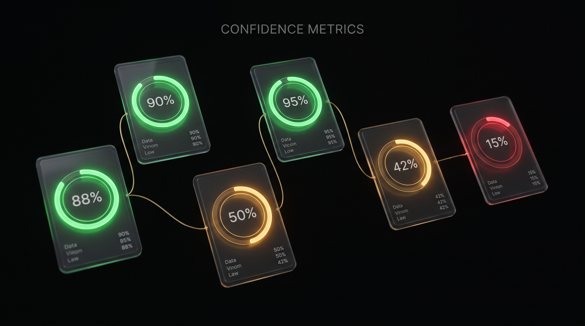
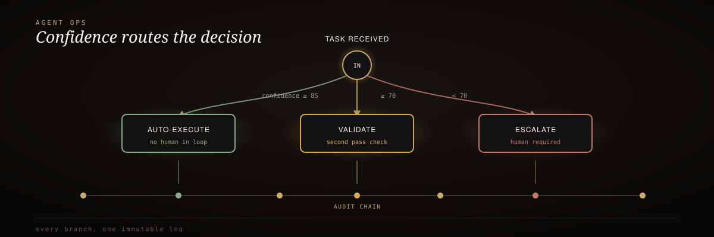

<div align="center">
  
</div>

<br/>

<div align="center">
  <h3>RIG-Enhanced Agent Ops</h3>
  <p><em>Proof-gated agent operations with a tamper-evident audit trail.</em></p>
</div>

<div align="center">


</div>

<br/>

> 🥇 Traditional agent observability records what happened, *after* it happened. That's necessary but not sufficient for agents that send money, delete data, or deploy code. Every action here is gated *before* it runs, and sealed into a chain that proves — to a party who trusts nothing but math — exactly what happened, in what order, untouched.

This is what [AgentOps](https://www.agentops.ai/)-style observability looks like once the [RIG doctrine overlay](../rig-doctrine-overlay) is applied: agent actions don't just get *logged*, they get *judged* before they run, and *sealed* into a blockchain-style chain.

## 60-second install

```python
from src.action_gate import ActionGate, EscalationRequired
from src.audit_trail import AuditTrail
from src.verifier import Verifier

trail = AuditTrail(secret="use-a-real-secret-in-production")
gate = ActionGate(audit_trail=trail)

def deploy(release_id: str) -> dict:
    return {"deployed": release_id, "region": "us-east-1"}

# high confidence -> runs immediately
result = gate.execute("deploy_release", deploy, "release-42", confidence=0.96)
print(result.status)  # GateStatus.AUTO_EXECUTED

# low confidence -> never runs, escalates instead
try:
    gate.execute("delete_production_database", deploy, "prod-db", confidence=0.40)
except EscalationRequired as exc:
    print(exc)  # action was never called

# ship the trail to an auditor who has never seen this process
report = Verifier(secret="use-a-real-secret-in-production").verify_json(trail.to_json())
assert report.valid
```

## How it works

<div align="center">
  
</div>

<sub align="center">action + confidence → ActionGate → ProofPacket (prev_hash + hash + signature) → AuditTrail → independent Verifier</sub>

## The confidence gate

| Confidence | Route | Behavior |
| :-- | :-- | :-- |
| **≥ 0.85** | `AUTO_EXECUTE` | Runs immediately, seals the proof |
| **0.70 – 0.85** | `VALIDATE` | Runs, optionally confirmed by an independent validator, seals the proof either way |
| **< 0.70** | `ESCALATE` | Never runs — seals the refusal and hands off to a human/process |

<sup>Both thresholds are configurable per <code>ActionGate</code>, but 0.85 / 0.70 is the RIG doctrine baseline.</sup>

## Why it is not "just logging"

- **A gate, not just a record** — [`ActionGate`](src/action_gate.py) sits *in front of* every action; below the escalation threshold, an action never runs, full stop
- **Tamper evidence, not just storage** — [`AuditTrail`](src/audit_trail.py) chains every ProofPacket to the one before it; edit any field and every hash from that point forward stops matching
- **A single tampered packet is one finding, not a cascade** — verification advances the expected `prev_hash` from each packet's *stored* hash
- **The verifier trusts nothing it didn't recompute itself** — it never calls back into a live `AuditTrail`'s internal state

<details>
<summary><strong>Tamper detection, live</strong></summary>

<br/>

```python
trail.tamper(0, output={"deployed": "not-what-actually-happened"})
ok, reason = trail.verify()
assert not ok
print(reason)  # "tamper detected at packet #0: stored hash ... does not
               #  match recomputed ..."
```

</details>

<details>
<summary><strong>L10 self-evolving smoke harness</strong></summary>

<br/>

```bash
.rig/smoke.sh
```

Runs a mock agent through the gate across six scenarios (auto-execute, validate, escalate, chain integrity, tamper detection, signature integrity) and journals every run to `.rig/.smoke-journal.json`. Any scenario that has ever failed has its `hardening_level` permanently ratcheted up. Hardening never regresses on a pass; only a failure raises it.

</details>

<details>
<summary><strong>L8 eight-layer verification gate</strong></summary>

<br/>

```bash
.rig/verify.sh
```

| # | Layer | What it checks |
| :-: | :-- | :-- |
| 1 | syntax | Every module compiles |
| 2 | unit | `pytest -m unit` — isolated component behavior |
| 3 | integration | `pytest -m integration` — full gate → trail → verifier pipeline |
| 4 | eval | Confidence-routing table swept across `[0, 1]` (1000+ points, doctrine-exact boundaries) |
| 5 | proof | Every sealed ProofPacket carries all required evidentiary fields |
| 6 | gate | The tamper-detection gate is proven to fire, on a fresh trail |
| 7 | audit | A 30-packet, mixed-outcome trail verifies end to end |
| 8 | sign-off | Hard `AND` of layers 1–7 → `.rig/gate-report.json` |

</details>

## Documentation

| Path | Role |
| :-- | :-- |
| [`src/action_gate.py`](src/action_gate.py) | `ActionGate` — confidence-gated execution wrapper |
| [`src/audit_trail.py`](src/audit_trail.py) | `AuditTrail` / `ProofPacket` — hash-chained, HMAC-signable ledger |
| [`src/verifier.py`](src/verifier.py) | `Verifier` — independent, from-scratch chain + signature recomputation |
| [`AGENTS.md`](AGENTS.md) | TAC doctrine for agents working in this repo |
| [`spec/features/gated-agent-actions.feature`](spec/features/gated-agent-actions.feature) | Executable Gherkin behavior spec |
| [LICENSE](LICENSE) | MIT |

---

<div align="center"><sub>Built by Mike Rodgers · Forward Deployed Engineer · <a href="https://rodgersintelligence.com">rodgersintelligence.com</a></sub></div>
