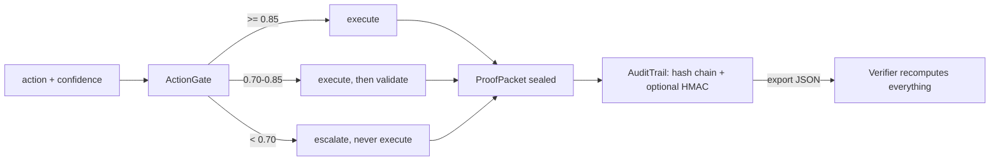

# RIG-Enhanced Agent Ops

Confidence-gated agent actions, sealed into a tamper-evident audit trail that an
independent verifier can check without trusting the process that wrote it. For teams
whose agents send money, delete data, or deploy code and who need proof of exactly
what ran, what did not, and why.

[](https://github.com/mrodgersjs-web/rig-enhanced-agent-ops/actions/workflows/ci.yml)
[](LICENSE)
[](https://www.python.org/downloads/)

## Why this exists

Logging what an agent did after it did it is not enough once actions are expensive or
irreversible. This library puts a decision in front of the action: run it, validate it,
or escalate it, based on the agent's own confidence. Every decision, including
refusals, is sealed into a hash chain, so the question "why did the agent do that?"
always has an answer on disk that nobody can quietly rewrite.

## Quickstart

```bash
git clone https://github.com/mrodgersjs-web/rig-enhanced-agent-ops.git
cd rig-enhanced-agent-ops
python3 -m venv .venv && . .venv/bin/activate
pip install -e '.[dev]'
rig-agent-ops demo
```

Real output of the last command:

```
auto action status: auto_executed
escalated action: never ran, sealed as packet #1
packets sealed: 2
trail valid: True
```

## Usage

```python
from src import ActionGate, AuditTrail, EscalationRequired, Verifier

trail = AuditTrail(secret="use-a-real-secret-in-production")
gate = ActionGate(audit_trail=trail)

result = gate.execute("deploy_release", lambda r: {"deployed": r}, "release-42",
                      confidence=0.96)
print(result.status.value)  # auto_executed

try:
    gate.execute("delete_production_database", lambda r: r, "prod-db", confidence=0.40)
except EscalationRequired as exc:
    print(exc)  # the action was never called; the refusal is sealed as packet #1

report = Verifier(secret="use-a-real-secret-in-production").verify_json(trail.to_json())
assert report.valid
```

The CLI ships three commands: `rig-agent-ops demo` runs the loop above,
`rig-agent-ops verify FILE` re-checks an exported trail (exit code 0 valid, 1 invalid),
and `rig-agent-ops inspect FILE` summarizes one.

## How it works



Each packet's hash covers its content plus the previous packet's hash, so any edit,
deletion, reorder, or truncation breaks verification. HMAC signatures add
authenticity when a shared secret is configured; integrity works without one.

## What it proves

- `pytest -q` covers the gate, the chain, tamper detection (edit, reorder,
  truncation), signature checks, and the CLI.
- `python examples/verify_trail.py` builds a trail, tampers with it, and prints the
  verifier rejecting the tampered copy.
- `rig-agent-ops verify` exits 1 on a tampered export, so it can gate a deploy script.

## Project layout

```
src/action_gate.py    confidence thresholds and gate decisions
src/audit_trail.py    ProofPacket, hash chain, HMAC signing, JSON export
src/verifier.py       independent recomputation of the whole chain
src/cli.py            rig-agent-ops command line (demo, verify, inspect)
test/                 pytest suite
examples/             runnable tamper-and-verify walkthrough
docs/                 architecture notes
```

## Development

```bash
pip install -e '.[dev]'
ruff check .
pytest -q --cov
```

## Contributing, security, license

See [CONTRIBUTING.md](CONTRIBUTING.md), [SECURITY.md](SECURITY.md), and the
[MIT license](LICENSE). Report security issues privately to
security@rodgersintelligence.com.

Built by Mike Rodgers · rodgersintelligence.com
