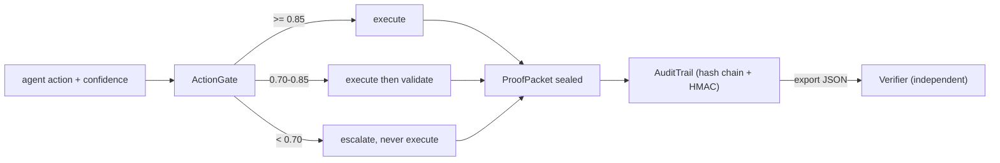

# Architecture

## The three pieces

1. **ActionGate** decides whether an agent action may run. It reads one number, the
   agent's self-reported confidence for that action:
   - 0.85 and above: auto execute.
   - 0.70 to 0.85: execute, then hand the output to an independent validator; a
     failed validation raises `ValidationFailed` and seals a `rejected` packet.
   - below 0.70: never execute; raise `EscalationRequired` and seal an `escalated`
     packet. The refusal is on disk like any execution would be.
2. **AuditTrail** seals every decision as a `ProofPacket`. Each packet's hash covers
   its own content plus the previous packet's hash, so edits, deletions, reorders
   and truncation all break the chain. An optional HMAC key adds authenticity:
   without the key nobody can forge a packet that still verifies.
3. **Verifier** re-checks a trail from raw exported JSON only. It never imports the
   in-memory objects that produced the trail; it recomputes every hash and
   signature from first principles, so a compromised process cannot talk its way
   out of a broken chain.

## Design notes

- The packet hash deliberately excludes `hash` and `signature` themselves, and the
  verifier reimplements hash computation instead of reusing `ProofPacket`, so a bug
  in one is unlikely to hide a bug in the other.
- `canonical_json` (sorted keys, fixed separators) is the single serialization used
  for hashing, so the same logical content hashes identically in any process.
- Tamper evidence needs no secret. Authenticity (HMAC) does. An unsigned trail is
  still fully integrity-checked.
- Exported trail JSON is the trust boundary: ship the file, not the process.

## CLI

`rig-agent-ops demo` runs the full loop in-process. `rig-agent-ops verify FILE`
re-checks an export and exits 0/1. `rig-agent-ops inspect FILE` summarizes one
without judging it.
